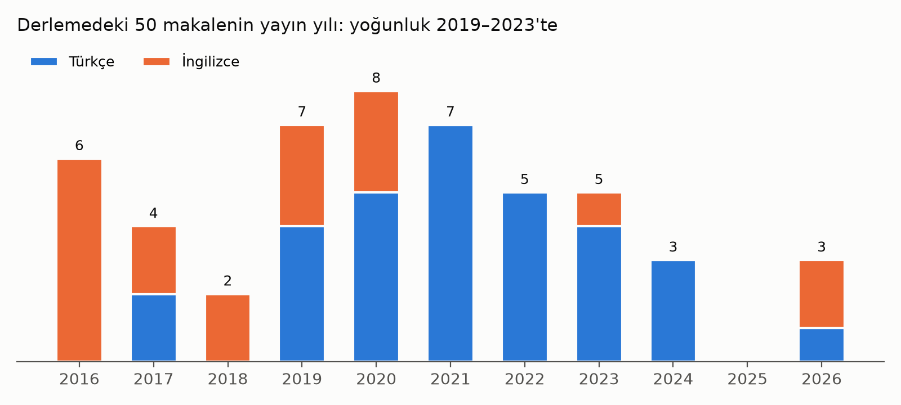
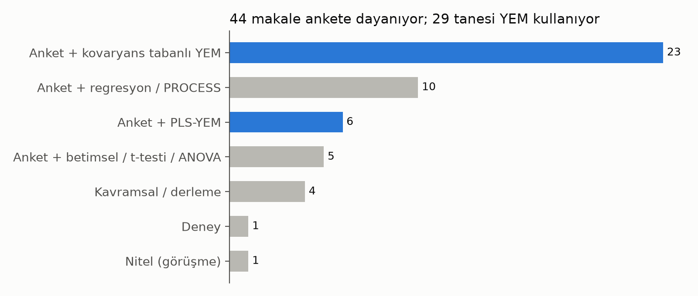
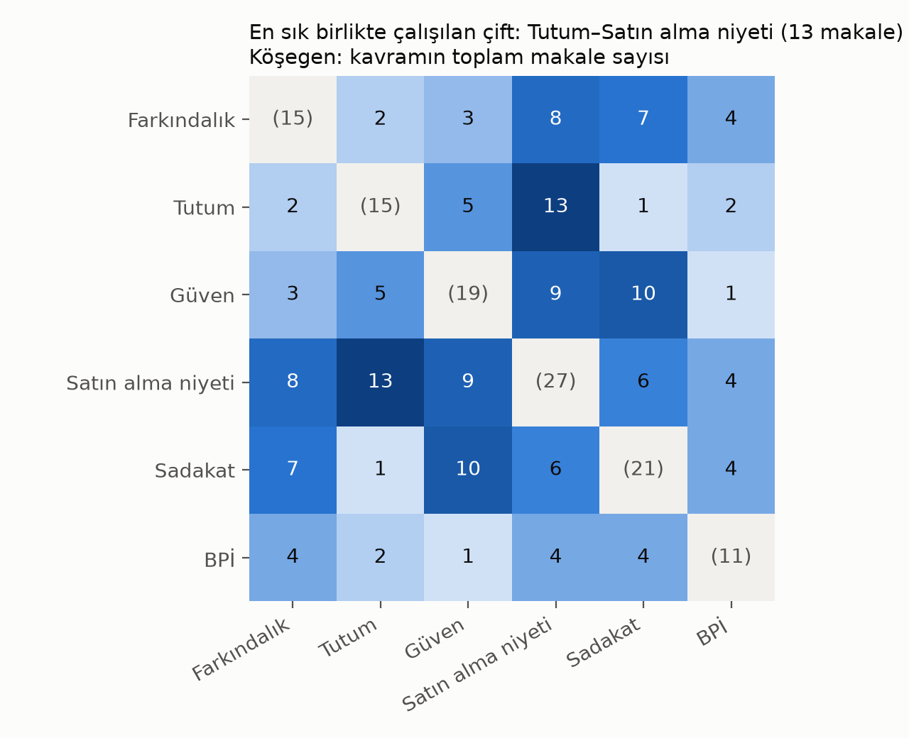
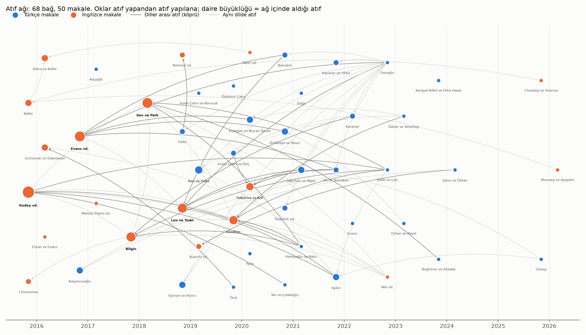

# Marka Farkındalığı, Güven, Tutum, Satın Alma Niyeti ve Sadakat: 2016–2026 Literatür Derlemesi

14 Kasım 2026 · Canlı belge (Claude Docs): https://claude.ai/artifact/GNXoZNPwWwXfvASXqUxkPJ

## Özet

Bu derleme, marka farkındalığı, marka güveni, markaya yönelik tutum, satın alma niyeti ve marka sadakatini bütünleşik (entegre) pazarlama iletişiminin (BPİ) tüketici tarafındaki çıktıları olarak ele alır ve kurumsal iletişim bakış açısıyla 2016–2026 literatürünü inceler. OpenAlex, Crossref ve DergiPark üzerinden taranan 1.115 kayıttan PRISMA benzeri bir akışla 50 hakemli makale seçildi (31 Türkçe, 19 İngilizce). Makaleler arasında 68 atıf bağı çıkarıldı. Bulgular, iletişim → farkındalık → tutum → güven → niyet → sadakat zincirini büyük ölçüde destekliyor: en tutarlı ilişki tutum → niyet, en sık aracı değişken marka güvenidir. Farkındalığın etkisi bağlama duyarlıdır ve pandemi gibi koşullarda kaybolabilir. Makalelerin 44'ü ankete, 29'u yapısal eşitlik modeline dayanıyor. Türkçe literatür influencer iletişimi ağırlıklıdır ve İngilizce çekirdek çalışmalara 29 kez atıf yaparken tersi yönde atıf yoktur. BPİ'yi beş çıktının tamamına bağlayan Türkçe nedensel bir çalışma bulunmaması en belirgin boşluktur.

**Anahtar kelimeler:** bütünleşik pazarlama iletişimi, entegre pazarlama iletişimi, marka farkındalığı, marka güveni, marka tutumu, satın alma niyeti, marka sadakati, kurumsal iletişim, bibliyometri

## Abstract

This review treats brand awareness, brand trust, brand attitude, purchase intention and brand loyalty as consumer-side outcomes of integrated marketing communications (IMC) and examines the 2016–2026 literature from a corporate communication perspective. From 1,115 records retrieved via OpenAlex, Crossref and DergiPark, a PRISMA-like process yielded 50 peer-reviewed articles (31 Turkish, 19 English), linked by 68 citation ties. The evidence largely supports the chain communication → awareness → attitude → trust → intention → loyalty: attitude → intention is the most consistent link and brand trust the most frequent mediator, while the effect of awareness depends on context and may disappear under conditions such as a pandemic. Of the 50 articles, 44 rely on surveys and 29 on structural equation modelling. The Turkish literature centres on influencer communication and cites the English core 29 times, with no citations in the opposite direction. The clearest gap is the absence of Turkish causal studies linking IMC to all five outcomes.

**Keywords:** integrated marketing communications, brand awareness, brand trust, brand attitude, purchase intention, brand loyalty, corporate communication, bibliometrics

## 1. Giriş

Bu derleme, marka farkındalığı, marka güveni, markaya yönelik tutum, satın alma niyeti ve marka sadakatini **bütünleşik (entegre) pazarlama iletişiminin çıktıları** olarak ele alır. Kurumsal iletişim açısından bu beş kavram, bir kurumun mesajlarının tüketici zihninde ve davranışında neye dönüştüğünü gösteren ölçütlerdir.

Pazarlama iletişimi; reklam, halkla ilişkiler, satış geliştirme, doğrudan pazarlama, sponsorluk ve dijital kanallar aracılığıyla bir markanın paydaşlarıyla kurduğu iletişimin bütünüdür. Bütünleşik pazarlama iletişimi (BPİ; İngilizce *integrated marketing communications*, IMC), bu araçların tek ve tutarlı bir marka sesiyle planlanmasını savunur (Batra ve Keller, 2016; Keller, 2016). Türkçe literatürde aynı kavram hem "bütünleşik" hem "entegre" pazarlama iletişimi olarak çevrilir (Eravcı, 2022; Mossarg ve Apaydın, 2026).

Sosyal medya bu iletişimi tek yönlü yayından çok yönlü bir etkileşime çevirdi. Firma kaynaklı içerik ile kullanıcı kaynaklı içerik artık aynı marka algısını birlikte biçimlendiriyor (Schivinski ve Dabrowski, 2016). Influencer'lar ise kurumla tüketici arasında yeni bir aracı katman oluşturdu (Lou ve Yuan, 2019). Bu dönüşüm, beş marka çıktısının nasıl oluştuğuna dair 2016 sonrası literatürü hızla büyüttü.

Derlemenin üç araştırma sorusu vardır:

1. 2016–2026 arasında bu beş kavram hangi iletişim bağlamlarında (sosyal medya, influencer, KSS, kurumsal itibar, BPİ) ve hangi yöntemlerle çalışıldı?
2. Farkındalık → tutum → güven → satın alma niyeti → sadakat zincirine dair bulgular ne söylüyor; hangi aracı ve düzenleyici değişkenler öne çıkıyor?
3. Türkçe ve İngilizce literatür birbirine nasıl bağlanıyor; atıf ağında hangi makaleler köprü görevi görüyor?

## 2. Yöntem

Tarama, 1.115 benzersiz kayıttan başladı ve 50 hakemli dergi makalesine indi: 31 Türkçe (%62), 19 İngilizce. Tarama 14 Kasım 2026'da yapıldı; tarih aralığı 2016–2026'dır.

### 2.1. Veri tabanları ve kaynaklar

- **OpenAlex** (api.openalex.org): İngilizce ve Türkçe aramaların ana kaynağı. DergiPark makalelerinin çoğu Crossref DOI'si taşıdığı için OpenAlex'te dizinlidir. Atıf ağı `referenced_works` alanından çıkarıldı.
- **DergiPark**: Türkçe makalelerin tam metinleri (PDF) buradan indirildi ve kaynakçaları tarandı. DergiPark'ın arama sayfası otomatik erişimde doğrulama istediği için arama OpenAlex üzerinden yapıldı.
- **Crossref**: Her makalenin yazar, yıl, başlık, dergi, cilt, sayı ve sayfa bilgisi DOI üzerinden doğrulandı.
- **İletişim fakültesi dergileri**: Selçuk İletişim, Erciyes İletişim, İletişim Kuram ve Araştırma, Galatasaray İleti-ş-im, Akdeniz İletişim, TRT Akademi, Türkiye İletişim Araştırmaları, Connectist, Etkileşim, Intermedia ve Yeni Medya dergileri ayrıca dergi filtresiyle tarandı.
- **Ek tarama**: "Entegre pazarlama iletişimi" terimi için Crossref ve web araması yapıldı (7 ek kayıt).

### 2.2. Anahtar kelimeler

- **Türkçe**: "marka farkındalığı", "marka güveni", "markaya yönelik tutum", "marka tutumu", "satın alma niyeti" + marka, "marka sadakati", "sosyal medya pazarlama" + marka, "kurumsal itibar", "kurumsal sosyal sorumluluk", "kurumsal imaj", "marka iletişimi", fenomen ve influencer, **"bütünleşik pazarlama iletişimi"** ve **"entegre pazarlama iletişimi"** (iki terim ayrı ayrı).
- **İngilizce**: beş kavramın ikili kombinasyonları (ör. "brand trust" AND "brand loyalty"), "social media marketing" + "brand equity", "electronic word of mouth" + "purchase intention", influencer, "corporate reputation", "corporate social responsibility", "brand communication" ve "integrated marketing communication(s)" + brand equity / trust / purchase intention / loyalty.

### 2.3. Dahil etme ve dışlama ölçütleri

| Ölçüt | Dahil | Dışlanan |
| --- | --- | --- |
| Tarih | 2016–2026 | 2016 öncesi (yalnız kuramsal çerçevede anıldı) |
| Yayın türü | Hakemli dergi makalesi | Tez, bildiri, kitap bölümü |
| Konu | En az iki hedef kavram ya da BPİ → marka çıktısı | Tek kavramlı, betimsel marka incelemeleri |
| Bağlam | İletişim bağlamı (sosyal medya, influencer, KSS, itibar, reklam, halkla ilişkiler, BPİ) öncelikli | Aynı ilişkiyi iletişim bağlamı olmadan tekrarlayanlar |
| Doğrulama | DOI ya da DergiPark sayfasıyla künye doğrulandı, özet veya tam metin okundu | Künyesi doğrulanamayan, tam metni açılamayan |
| Dil | Türkçe ve İngilizce; en az %60 Türkçe | Diğer diller |

### 2.4. Tarama akışı (PRISMA benzeri)

1. **Tanımlama**: 35 OpenAlex sorgusundan 1.108 benzersiz kayıt + ek taramadan 7 kayıt = 1.115 kayıt.
2. **Tarama**: Başlık ve özette en az iki hedef kavram ya da BPİ geçen 616 kayıt kaldı (213'ü Türkçe).
3. **Uygunluk**: İletişim bağlamı, dergi niteliği, atıf sayısı ve ağ bağlantısına göre 66 aday seçildi; 66'sının künyesi Crossref'te doğrulandı.
4. **Dışlama**: 16 aday çıkarıldı. 14'ü odak dışı ya da aynı ilişkiyi iletişim bağlamı olmadan tekrarlıyordu. Biri aynı başlıkla iki ayrı dergide yayımlanmıştı (mükerrer yayın şüphesi). Birinin tam metnine erişilemedi (HTTP 403).
5. **Dahil**: 50 makale (31 Türkçe, 19 İngilizce). Ayrıca künyesi doğrulanamayan 2 aday hiç listeye alınmadı.

*Şekil: Tarama akışı (huni) Docs belgesinde: 1.115 → 616 → 66 → 50.*

### 2.5. Bibliyometrik işlem

Atıf bağları iki yoldan çıkarıldı: OpenAlex `referenced_works` alanı (62 bağ) ve 41 Türkçe/İngilizce PDF'in kaynakça taraması (6 ek bağ, her biri elle kontrol edildi). Kavram eş-oluşumu, yöntem dağılımı ve köprü makaleler Python (networkx, matplotlib) ile hesaplandı. Betikler ve ham veri `alphy/marka-literatur/bibliyometri/` klasöründedir.

## 3. Kavramsal ve kuramsal çerçeve

Bu derleme beş marka kavramını, pazarlama iletişiminin ve onun bütünleşik biçiminin (BPİ) tüketici tarafındaki çıktıları olarak okur. Bu bölümdeki 2016 öncesi klasikler yalnız kuramsal çerçeve için kullanıldı; tarama sayısına ve atıf ağına girmedi.

### 3.1. Pazarlama iletişiminden bütünleşik pazarlama iletişimine

**Pazarlama iletişimi**, bir kurumun reklam, halkla ilişkiler, satış geliştirme, doğrudan pazarlama, sponsorluk ve dijital kanallarla hedef kitlelerine gönderdiği mesajların bütünüdür (Batra ve Keller, 2016). **Bütünleşik pazarlama iletişimi** bu araçların ayrı ayrı değil, tek bir strateji ve tutarlı bir marka sesiyle planlanmasıdır (Schultz vd., 1993; Kitchen vd., 2004). Duncan ve Moriarty (1998) BPİ'yi ilişki yönetimine bağlar: tutarlı iletişim güveni, güven de uzun dönemli ilişkiyi besler.

**Bileşenler.** Klasik karmada reklam, halkla ilişkiler, satış geliştirme, kişisel satış ve doğrudan pazarlama bulunur. Dijital dönemde bunlara sosyal medya, arama, mobil, influencer ve içerik pazarlaması eklendi (Batra ve Keller, 2016). Türkiye'deki ajans profesyonelleri BPİ'yi hâlâ çoğunlukla reklam ile halkla ilişkilerin taktiksel koordinasyonu olarak tanımlıyor (Dağlı, 2021).

**Tarihsel gelişim.** Kitchen ve Schultz (1999) BPİ'nin dört aşamada geliştiğini gösterir:

1. İletişim araçlarının taktiksel koordinasyonu.
2. Pazarlama iletişiminin kapsamının yeniden tanımlanması.
3. Bilgi teknolojisinin kullanılması.
4. Finansal ve stratejik bütünleşme.

**Dijital dönem.** Batra ve Keller (2016), farklı kanalların karar yolculuğunun farklı aşamalarına hizmet ettiğini ve programın bu aşamalara göre eşleştirilmesi gerektiğini savunur. Keller (2016) bir BPİ programını yedi ölçütle değerlendirir: kapsam, katkı, ortaklık, tamamlayıcılık, çok yönlülük, maliyet ve öncelik. Manser Payne vd. (2017) çok kanallı ortamda kanal ve mesaj birliğini tüketici bağlılığının koşulu olarak tanımlar. Šerić vd. (2020) ise tüketicinin algıladığı iletişim tutarlılığının marka güveni ve sadakatini doğrudan artırdığını ampirik olarak gösterir.

**Terminoloji: bütünleşik mi, entegre mi?** İngilizce *integrated marketing communications* (IMC) Türkçeye iki biçimde çevrilir. İkisi aynı kavramdır. Bu taramada OpenAlex'te başlık ve özetinde "bütünleşik pazarlama iletişimi" geçen 35 kayıt, "entegre pazarlama iletişimi" geçen 1 kayıt bulundu. Hakemli Türkçe literatür "bütünleşik" terimini tercih ediyor (Aslan Çetin ve Korucuk, 2019; Ayas, 2020; Eravcı, 2022). "Entegre" daha çok sektör dilinde ve ara metinlerde yaşıyor; Mossarg ve Apaydın (2026) aynı makalenin Türkçe özetinde "entegre", anahtar kelimesinde "bütünleşik" terimini birlikte kullanıyor. Bu derleme "bütünleşik pazarlama iletişimi (BPİ)" terimini kullanır.

### 3.2. Beş marka kavramı

| Kavram | Tanım | Kuramsal dayanak | Bu derlemede makale |
| --- | --- | --- | --- |
| Marka farkındalığı | Tüketicinin markayı tanıma ve hatırlama yeteneği; marka bilgisinin ilk katmanı | Aaker (1991); Keller (1993) | 15 |
| Markaya yönelik tutum | Markaya ilişkin görece kalıcı, tek boyutlu genel değerlendirme | Spears ve Singh (2004) | 15 |
| Marka güveni | Tüketicinin markanın vaat ettiği işlevi yerine getireceğine güvenme isteği | Chaudhuri ve Holbrook (2001); Morgan ve Hunt (1994) | 19 |
| Satın alma niyeti | Bireyin markayı satın almaya yönelik bilinçli planı | Spears ve Singh (2004) | 27 |
| Marka sadakati | Tercih edilen markayı gelecekte de yeniden satın alma taahhüdü; bilişsel, duygusal, konatif ve eylem aşamaları | Oliver (1999); Dick ve Basu (1994) | 21 |

**Kuramsal bağ.** Aaker (1991) farkındalık ve sadakati marka değerinin boyutları sayar. Keller'in (1993) tüketici temelli marka değeri modeli, farkındalık ve imajın oluşturduğu marka bilgisinin tüketici tepkisini belirlediğini öne sürer. Chaudhuri ve Holbrook (2001) güvenin sadakate, sadakatin marka performansına uzanan zincirini kurar. Morgan ve Hunt (1994) güveni ilişki bağlılığının anahtar aracısı olarak konumlar. Bu modeller birlikte okunduğunda beş kavram bir **iletişim → bilgi → değerlendirme → davranış** zinciri oluşturur. Bölüm 4 bu zinciri 2016–2026 bulgularıyla sınar.

## 4. Kavramlar arası ilişkiler: iletişimden sadakate

Bulgular zinciri büyük ölçüde destekliyor, ama tek çizgide değil: güven ve tutum çoğu modelde **aracı** olarak çalışıyor, farkındalığın etkisi ise bağlama göre zayıflıyor. Bu bölüm önce BPİ'nin çıktılara etkisini, sonra zincirin halkalarını, en sonda birbirine atıf yapan çalışma zincirlerini anlatır.

*Şekil: Kavramsal model Docs belgesinde (BPİ öncül → farkındalık → tutum → güven → satın alma niyeti → sadakat).*

Vurgulu kutular en sık aracı olan iki kavramdır. Kesikli ok, güvenin sadakate doğrudan bağını gösterir.

### 4.1. BPİ ve iletişim tutarlılığının marka çıktılarına etkisi

- **Güven ve sadakat.** Šerić vd. (2020), 452 fast-food müşterisinde algılanan iletişim tutarlılığının marka güveni ve sadakati doğrudan artırdığını gösterdi. Bu, Duncan ve Moriarty'nin (1998) "tutarlı iletişim güven doğurur" önermesinin doğrudan sınanmasıdır.
- **Farkındalık ve satın alma niyeti.** Choubey ve Sharma (2026), yeşil BPİ'nin yeşil marka farkındalığı, imajı ve değerini; marka değerinin de satın alma niyetini artırdığını buldu. Mossarg ve Apaydın (2026) Türkiye'de viral pazarlamanın niyeti artırdığını ve farkındalığın bu etkiye kısmi aracılık ettiğini gösterdi; geleneksel kanalları BPİ içinde destekleyici düzenleyici olarak modelledi.
- **Marka iletişimi ve halkla ilişkiler.** Chinomona (2016), marka iletişiminin imaj üzerinden güvene, güvenin sadakate taşındığını buldu. Koçyiğit (2017) halkla ilişkiler algısının marka imajı ve bağlılığı doğrudan ve imaj üzerinden dolaylı artırdığını gösterdi.
- **Firma düzeyi.** Ayas (2020), 127 işletmede BPİ'nin dört boyutunun marka performansıyla ilişkili olduğunu buldu. Tüketici tarafında ise BPİ faaliyetlerine tutum demografik gruplara göre farklılaşıyor (Aslan Çetin ve Korucuk, 2019), influencer içeriği de BPİ'nin bir kanalı olarak satın almayı çoğu kez dolaylı etkiliyor (Aslan Çetin ve Öziç, 2020).

### 4.2. Farkındalık → tutum → satın alma niyeti

Farkındalık zincirin giriş halkasıdır. Orhan ve Akyol (2023) farkındalığın satın alma niyetine etkisine tutumun aracılık ettiğini gösterdi; bu, Keller'in (1993) marka bilgisi → tüketici tepkisi önermesine doğrudan kanıttır. Sosyal medya pazarlaması farkındalığı artırıyor (Godey vd., 2016; Seo ve Park, 2018; Bilgin, 2018), influencer'a duyulan güven de farkındalığa taşınıyor (Lou ve Yuan, 2019; Uğurhan ve Yaşar, 2021). Günay (2026) nitel verilerle farkındalığın tek seferlik bir çıktı değil, tekrar ve gündelik bağlamda maruziyetle kademeli kurulan bir süreç olduğunu gösterdi.

**Tutarlı olmayan bulgu.** Wei vd. (2023) pandemi döneminde farkındalık, güven ve algılanan kalitenin niyete etkisini anlamsız buldu; yalnız duygusal boyutlar (çağrışım ve sadakat) niyeti etkiledi. Bilgin (2018) de farkındalığın imaja etkisini sınırlı buldu. Yani farkındalık gerekli ama tek başına yeterli değil.

### 4.3. Tutum → satın alma niyeti

En sık sınanan ve en tutarlı ilişki budur (13 makale). Kullanıcı kaynaklı sosyal medya içeriği tutumu artırıyor, tutum da niyeti (Schivinski ve Dabrowski, 2016). Reklama tutum marka tutumunu, marka tutumu niyeti etkiliyor ve aradaki ilişkiye kısmi aracılık ediyor (Başaran ve Yıldız, 2022). Fonksiyonel, deneyimsel ve sembolik marka faydaları niyete tutum üzerinden ulaşıyor; tutum niyetin %50'sini açıklıyor (Yıldız, 2019). KSS'nin niyete etkisi de doğrudan değil, imaj ve tutum üzerinden geçiyor (Ramesh vd., 2019). Influencer çalışmalarında kaynak güvenilirliği ve çekicilik tutumu, tutum niyeti artırıyor (Avcı ve Yıldız, 2019; Ali ve Temizkan, 2022; Sarıoğlu, 2023). Evans vd. (2017) ise bir sınır gösterir: reklam olduğu açıkça belirtilen influencer içeriği tutumu düşürebiliyor.

### 4.4. Güven: zincirin merkezindeki aracı

Güven en çok aracı olarak modellenen kavramdır.

- **İletişim → güven → sadakat.** Sosyal medya pazarlaması güveni, güven sadakati artırıyor (Ebrahim, 2020; Hamşıoğlu ve Nalcı, 2021). THY örneğinde SMP marka güvenini ve tercihi artırdı (Begtimur ve Alizade, 2024). Tatminin sadakate etkisine güven kısmi aracılık ediyor (Tan ve Çolakoğlu, 2021).
- **Kurumsal itibar → güven → sadakat.** Bankacılıkta çalışma ortamı, duygusal çekicilik ve sosyal sorumluluk sadakate güven üzerinden ulaşıyor (Karayel Bilbil ve Orha Hazar, 2024).
- **Influencer → marka güveni → niyet.** Influencer'a tutumun niyete etkisinde marka güveni çekicilik ve güvenilirlikte tam aracı (Özkan ve Yerezhep, 2023). Ünlü desteğinin niyete etkisine marka güvenilirliği ve sadakat aracılık ediyor (Karahan, 2022).
- **Güvenden sadakate duygusal köprü.** Kalyoncuoğlu (2017), güvenin sadakate etkisinin tamamen marka aşkı üzerinden geçtiğini buldu. Bu, Chaudhuri ve Holbrook'un (2001) güven ve duygu zincirinin Türkiye'deki bir sınamasıdır.

### 4.5. Satın alma niyeti ve sadakat

Yön tartışmalı. Bazı modellerde sadakat niyetin öncülü (Şancı ve Özkan, 2024; Karahan, 2022; Bianchi vd., 2019), bazılarında niyet sadakatin konatif aşamasıdır (Oliver, 1999). Bianchi vd. (2019) KSS → imaj → tatmin → sadakat zincirinin hem kurumsal itibarı (uzun vade) hem satın alma niyetini (kısa vade) artırdığını gösterdi. Bu, kurumsal iletişimin iki zaman ölçeğini aynı modelde birleştiren nadir çalışmalardandır.

### 4.6. Aracı ve düzenleyici değişkenler

| Değişken | Rolü | Yol | Çalışma |
| --- | --- | --- | --- |
| Marka güveni | Aracı | SMP / itibar / influencer → güven → sadakat, niyet | Ebrahim (2020); Karayel Bilbil ve Orha Hazar (2024); Özkan ve Yerezhep (2023) |
| Markaya yönelik tutum | Aracı | Reklama tutum / farkındalık → tutum → niyet | Başaran ve Yıldız (2022); Orhan ve Akyol (2023) |
| Marka imajı | Aracı | SMP / halkla ilişkiler / KSS → imaj → sadakat, niyet | Dilek ve Çatı (2023); Koçyiğit (2017); Ramesh vd. (2019) |
| Marka farkındalığı | Aracı | Viral pazarlama → farkındalık → niyet | Mossarg ve Apaydın (2026) |
| Parasosyal ilişki | Aracı | Güven → parasosyal ilişki → farkındalık | Uğurhan ve Yaşar (2021); Sokolova ve Kefi (2020) |
| Marka aşkı | Aracı | Güven → aşk → sadakat | Kalyoncuoğlu (2017) |
| Tüketici-firma özdeşleşmesi | Aracı | KSS → özdeşleşme → niyet | Özdemir Çakır (2020) |
| Reklam açıklaması | Düzenleyici | "Paid Ad" ifadesi tutumu düşürüyor | Evans vd. (2017) |
| Geleneksel pazarlama | Düzenleyici | Viral pazarlama → farkındalık ilişkisi | Mossarg ve Apaydın (2026) |
| Eğitim düzeyi | Düzenleyici | Marka değeri → yeşil niyet | Choubey ve Sharma (2026) |
| Pandemi bağlamı | Bağlamsal koşul | Farkındalık ve güvenin niyete etkisi kayboluyor | Wei vd. (2023) |

### 4.7. Birbirine atıf yapan çalışma zincirleri

**Zincir A, sosyal medya pazarlaması → marka değeri.** Godey vd. (2016) lüks markalarda SMP'nin farkındalık ve imaj üzerinden sadakate ulaştığını gösterdi. Seo ve Park (2018) bu bulguyu kurumsal bir havayolu markasında sınadı ve trend olma boyutunu en güçlü bileşen olarak buldu. Bilgin (2018) iki çalışmaya da atıf yaparak modeli Türkiye'ye taşıdı ve farkındalığın sadakate etkisini doğruladı. Ebrahim (2020) bu üç çalışmayı temel alıp modele güveni aracı olarak ekledi. Hamşıoğlu ve Nalcı (2021) dörtüne de atıf yaparak güven → bağlılık yolunu Türk e-ticaret müşterilerinde yeniden üretti. Dilek ve Çatı (2023) aynı zinciri hazır giyime taşıyıp aracı olarak imajı öne çıkardı. Wei vd. (2023) ise aynı kaynaklara dayanarak pandemide farkındalık ve güvenin etkisinin kaybolduğunu gösterdi; zincirin sınır koşulunu ortaya koydu. Begtimur ve Alizade (2024) Seo ve Park'ı (2018) THY'de tekrarladı.

**Zincir B, influencer iletişimi → tutum, güven ve niyet.** Evans vd. (2017) reklam açıklamasının tutuma etkisini gösterdi. Lou ve Yuan (2019) Evans'a dayanarak mesaj değeri ve kaynak güvenilirliğinin markalı içeriğe güven, oradan farkındalık ve niyet doğurduğunu buldu. Türkçe literatür bu iki makaleyi hızla benimsedi: Erdoğan ve Mucan Özcan (2020), Barüönü (2021), Ünlükaya ve Tosun (2021) ve Ali ve Temizkan (2022) Evans'a; Uğurhan ve Yaşar (2021), Aydın (2022) ve Ali ve Temizkan (2022) Lou ve Yuan'a atıf yaptı. Sarıoğlu (2023) bu kümenin düğüm noktasıdır: derlemedeki 13 makaleye atıf yaparak 3.127 kişilik örneklemle kaynak güvenilirliği → tutum → niyet yolunu doğruladı. Günay (2026) Aydın (2022) ile Uğurhan ve Yaşar'a (2021) dayanarak farkındalığı nitel yöntemle süreç olarak yeniden ele aldı.

**Zincir C, KSS ve güven.** Bianchi vd. (2019) KSS → itibar ve niyet zincirini kurdu. Şancı ve Özkan (2024) Bianchi'ye ve Kalyoncuoğlu'na (2017) atıf yaparak yeşil KSS algısının güven ve sadakat üzerinden niyeti artırdığını gösterdi.

**Zincir D, BPİ kuramı.** Batra ve Keller (2016) ile Keller (2016) BPİ'nin çağdaş çerçevesini kurdu. Šerić vd. (2020) Batra ve Keller'e dayanarak tutarlılığın güven ve sadakate etkisini ölçtü. Choubey ve Sharma (2026) ile Mossarg ve Apaydın (2026) Keller'e (2016) dayanarak BPİ çerçevesini satın alma niyeti modellerinde kullandı.

## 5. Bibliyometrik bulgular

50 makale arasında 68 atıf bağı var: 62'si OpenAlex'ten, 6'sı PDF kaynakçalarından. Bağların 29'u Türkçeden İngilizceye, 22'si Türkçe içinde, 17'si İngilizce içinde; İngilizceden Türkçeye bağ yok. Tüm kenarlar `atif-agi.csv` dosyasındadır.

### 5.1. Yıllara göre yayın

İngilizce çekirdek çalışmalar (Godey vd., 2016; Schivinski ve Dabrowski, 2016; Seo ve Park, 2018) dönemin başında yayımlandı; Türkçe literatür onları 2019–2024'te izledi. 2025'te seçim ölçütlerini karşılayan makale bulunmadı; 2026'da BPİ odaklı üç yeni çalışma var.

### 5.2. Yöntemler

Kesitsel anket ve YEM baskın. Tek deney Evans vd. (2017), tek nitel çalışma Günay'dır (2026). Dört makale kavramsal ya da derlemedir ve hepsi BPİ üzerinedir.

### 5.3. Kavram eş-oluşumu

Kavram sıklığı: satın alma niyeti 27, sadakat 21, güven 19, farkındalık 15, tutum 15, BPİ 11 makalede. Tutum ile sadakat (1) ve BPİ ile güven (1) neredeyse hiç birlikte çalışılmamış; bu iki çift en açık araştırma fırsatlarıdır.

### 5.4. Atıf ağı ve kümeler

Ağın en çok atıf alan düğümleri Godey vd. (2016; 8 atıf), Seo ve Park (2018; 6), Evans vd. (2017; 6), Bilgin (2018; 5), Lou ve Yuan (2019; 5) ve Ebrahim'dir (2020; 4). En çok atıf yapan Sarıoğlu'dur (2023; 13). Modülerlik analizi altı küme verdi; 9 makalenin ağ içinde hiç bağı yok.

*Şekil: Atıf ağı. Oklar atıf yapandan atıf yapılana gider; daire büyüklüğü ağ içinde alınan atıf sayısıdır. Kaynak: OpenAlex `referenced_works` ve PDF kaynakça taraması (atif-agi.csv).*

| Küme | Makale | Çekirdek | Üyeler |
| --- | --- | --- | --- |
| K1 Influencer iletişimi | 15 | Evans vd. (2017); Lou ve Yuan (2019) | Avcı ve Yıldız; Oyman ve Akıncı; Uğurhan ve Yaşar; Baruönü; Ünlükaya ve Tosun; Özdemir vd.; Ali ve Temizkan; Aydın; Karahan; Başaran ve Yıldız; Sarıoğlu; Orhan ve Akyol; Günay |
| K2 Sosyal medya pazarlaması ve marka değeri | 12 | Godey vd. (2016); Seo ve Park (2018); Bilgin (2018) | Schivinski ve Dabrowski; Chinomona; Ebrahim; Öcel; Tan ve Çolakoğlu; Hamşıoğlu ve Nalcı; Dilek ve Çatı; Wei vd.; Begtimur ve Alizade |
| K3 BPİ kuramı | 5 | Batra ve Keller (2016); Keller (2016) | Šerić vd.; Choubey ve Sharma; Mossarg ve Apaydın |
| K4 Influencer güvenilirliği ve satın alma | 4 | Sokolova ve Kefi (2020) | Erdoğan ve Mucan Özcan; Aslan Çetin ve Öziç; Özkan ve Yerezhep |
| K5 KSS, güven ve sadakat | 3 | Bianchi vd. (2019) | Kalyoncuoğlu; Şancı ve Özkan |
| K6 KSS ve tutum | 2 | Ramesh vd. (2019) | Yıldız (2019) |
| Bağsız | 9 | — | Erkan ve Evans; Manser Payne vd.; Karayel Bilbil ve Orha Hazar; Koçyiğit; Özdemir Çakır; Aslan Çetin ve Korucuk; Ayas; Dağlı; Eravcı |

### 5.5. Türkçe–İngilizce köprü makaleler

Köprü makale, hem Türkçe hem İngilizce makalelerle atıf bağı kuran makaledir. En güçlü köprü Bilgin'dir (2018): Türkiye'de toplanmış veriyi İngilizce yayımladığı için hem Türkçe makaleler hem Ebrahim (2020) ve Wei vd. (2023) ona atıf yapıyor.

| Makale | Dil | Bağlı Türkçe makale | Bağlı İngilizce makale | Köprü rolü |
| --- | --- | --- | --- | --- |
| Bilgin (2018) | İngilizce (Türkiye verisi) | 3 | 5 | Türkiye bulgusunu uluslararası literatüre taşıyan tek makale |
| Godey vd. (2016) | İngilizce | 4 | 4 | SMP modelinin kaynağı |
| Seo ve Park (2018) | İngilizce | 3 | 4 | Kurumsal havayolu markası modeli; THY çalışmasına taşındı |
| Ebrahim (2020) | İngilizce | 3 | 4 | Güveni aracı olarak Türkçe modellere getirdi |
| Lou ve Yuan (2019) | İngilizce | 5 | 1 | Influencer güven modelinin kaynağı |
| Evans vd. (2017) | İngilizce | 5 | 1 | Reklam açıklaması ve tutum |
| Sarıoğlu (2023) | Türkçe | 11 | 2 | Türkçe influencer literatürünün düğüm noktası |
| Dilek ve Çatı (2023) | Türkçe | 2 | 4 | SMP zincirini Türkçe literatürde birleştiriyor |

## 6. Türkiye bağlamına özgü bulgular

Türkçe literatürün ağırlık merkezi influencer iletişimidir: 31 Türkçe makalenin 13'ü fenomen veya influencer üzerine. Onu sosyal medya pazarlaması (5), BPİ (4), KSS (2), reklam (2), kurumsal itibar (1) ve halkla ilişkiler (1) izliyor.

**1. Kurumsal markalar ve itibar.** Türkçe çalışmalar kurumsal markaları doğrudan test ediyor: THY'nin sosyal medya faaliyetleri güveni ve tercihi artırıyor (Begtimur ve Alizade, 2024); en beğenilen bankaların itibar boyutları sadakate güven üzerinden ulaşıyor (Karayel Bilbil ve Orha Hazar, 2024); bir mobil iletişim markasında halkla ilişkiler algısı imaj ve bağlılığı artırıyor (Koçyiğit, 2017). Kurumsal iletişim açısından bu üç çalışma, itibar ve halkla ilişkilerin marka güveni ve sadakatine dönüştüğünü yerel veriyle gösteriyor.

**2. Influencer'da uzmanlık çelişkisi.** Uzmanlık boyutu birden çok Türk örnekleminde tutum ve niyete anlamlı etki göstermiyor (Avcı ve Yıldız, 2019; Özkan ve Yerezhep, 2023). Ali ve Temizkan (2022) ise uzmanlığın tutumu artırdığını buldu. Güvenilirlik ve çekicilik daha tutarlı belirleyiciler (Sarıoğlu, 2023; Erdoğan ve Mucan Özcan, 2020). Bu, Lou ve Yuan'ın (2019) güvenilirlik ve benzerlik vurgusuyla uyumlu.

**3. Kendini dışarda tutma (üçüncü kişi etkisi).** Katılımcılar satın alma öncesi fenomen içeriğine bakıyor ama etkilenenlerin "başkaları" olduğunu düşünüyor (Aslan Çetin ve Öziç, 2020). Z kuşağı vlogger'larla parasosyal ilişki kuruyor ve önerilerini kararlarında dikkate alıyor (Oyman ve Akıncı, 2019). Kadınlar mikro etkileyici kullanan markalara daha olumlu tutum gösteriyor (Ünlükaya ve Tosun, 2021).

**4. KSS ve güven.** Yeşil KSS algısı güveni ve sadakati, üçü birlikte satın alma niyetini artırıyor (Şancı ve Özkan, 2024). KSS imajı niyete prestij ve tüketici-firma özdeşleşmesi üzerinden ulaşıyor (Özdemir Çakır, 2020).

**5. BPİ literatürü ayrı bir adada.** Türkçe BPİ çalışmaları çoğunlukla betimsel (Aslan Çetin ve Korucuk, 2019), firma düzeyinde (Ayas, 2020), sektör görüşü (Dağlı, 2021) ya da kuramsal (Eravcı, 2022). BPİ'yi beş marka çıktısına nedensel bağlayan Türkçe hakemli makale bulunamadı. Bu dört çalışmanın atıf ağında hiç bağı yok.

**6. Yöntem profili.** Türkçe makalelerin 28'inde örneklem sayısı verilmiş; ortanca yaklaşık 400 kişi (15 ile 3.127 arası). Altı çalışma üniversite öğrencileri veya personeliyle, çoğu kolayda örneklemle yapıldı (ör. Ali ve Temizkan, 2022; Karahan, 2022; Tan ve Çolakoğlu, 2021). Tek nitel çalışma Günay'dır (2026).

**7. Tek yönlü bilgi akışı.** Türkçe makaleler İngilizce çekirdek makalelere 29 kez atıf yapıyor; İngilizce makalelerden Türkçe makalelere hiç atıf yok. Uluslararası literatüre Türkiye'den ulaşan tek çalışma, İngilizce yayımlanan Bilgin'dir (2018): Ebrahim (2020) ve Wei vd. (2023) ona atıf yapıyor.

## 7. Literatürdeki boşluklar ve gelecek araştırma önerileri

En büyük boşluk, BPİ'nin beş marka çıktısının tamamına aynı modelde bağlanmamasıdır; özellikle Türkçede bu bağ hiç sınanmamış.

| Boşluk | Kanıt | Öneri |
| --- | --- | --- |
| BPİ → beş çıktı tam zinciri yok | 50 makaleden hiçbiri beş kavramı birlikte ölçmüyor; BPİ ile güvenin birlikte çalışıldığı tek makale Šerić vd. (2020) | Tüketicinin algıladığı BPİ tutarlılığı → farkındalık → tutum → güven → niyet → sadakat modelinin YEM ile Türkiye'de sınanması |
| "Entegre" ve "bütünleşik" terim dağınıklığı | OpenAlex'te 35'e 1; aynı makalede iki terim birlikte (Mossarg ve Apaydın, 2026) | Türkçe terminoloji standardizasyonu ve tarama yaparken iki terimin birlikte kullanılması |
| Kurumsal iletişim çalışmaları ağın dışında | Kurumsal itibar, halkla ilişkiler, KSS ve BPİ makalelerinden 8'inin hiç atıf bağı yok (Karayel Bilbil ve Orha Hazar, 2024; Koçyiğit, 2017; Ayas, 2020) | Pazarlama ve iletişim fakültesi literatürlerinin karşılıklı atıfı; disiplinler arası ekipler |
| Satın alma niyeti ile sadakat arasındaki yön belirsiz | Kimi modelde sadakat niyetin öncülü (Karahan, 2022), kimisinde sonucu (Oliver, 1999) | Boylamsal veya panel tasarımlar; niyetin gerçek satın almaya dönüşümünün ölçülmesi |
| Kesitsel anket ağırlığı | 44 anket, 1 deney, 1 nitel çalışma | Deneysel tasarım (ör. reklam açıklaması, Evans vd., 2017), dijital iz verisi, nitel süreç çalışmaları (Günay, 2026) |
| Öğrenci ve kolayda örneklem | Türkçe çalışmaların altısı üniversite örneklemi | Kotalı ve sektör temelli örneklem, çok gruplu karşılaştırma |
| Bağlam koşulları az sınanıyor | Pandemi farkındalık ve güvenin etkisini siliyor (Wei vd., 2023) | Kriz, boykot ve marka aktivizmi dönemlerinde zincirin sınanması |
| KSS iletişiminin uzun vade etkisi | KSS → itibar ve niyeti aynı anda ölçen tek çalışma Bianchi vd. (2019) | KSS ve sürdürülebilirlik iletişiminin itibar, güven ve sadakat üzerindeki uzun vadeli etkisi |
| Türkçe bulgular uluslararası literatüre ulaşmıyor | İngilizceden Türkçeye 0 atıf; tek köprü Bilgin (2018) | Türkiye verisinin İngilizce yayımlanması, çok ülkeli karşılaştırmalar |
| Yapay zekâ ve sanal influencer | Derlemedeki 50 makalenin hiçbiri sanal influencer ya da yapay zekâ içeriğini test etmiyor | Sanal influencer ve yapay zekâ üretimli içeriğin güven ve tutuma etkisi |

## 8. Sonuç

2016–2026 literatürü, pazarlama iletişiminin marka farkındalığı, tutum, güven, satın alma niyeti ve sadakat üzerindeki etkisini büyük ölçüde destekliyor; zincirin merkezinde güven ve tutum aracı olarak duruyor.

1. **BPİ bir öncül olarak çalışıyor.** Tutarlı iletişim güveni ve sadakati artırıyor (Šerić vd., 2020), bütünleşik program farkındalık üzerinden niyete ulaşıyor (Choubey ve Sharma, 2026; Mossarg ve Apaydın, 2026).
2. **En sağlam halka tutum → niyet,** en bağlama duyarlı halka farkındalık → niyettir (Başaran ve Yıldız, 2022; Wei vd., 2023).
3. **Güven, iletişimin sadakate dönüştüğü yerdir.** Sosyal medya, kurumsal itibar ve influencer etkisi sadakate büyük ölçüde güven üzerinden ulaşıyor (Ebrahim, 2020; Karayel Bilbil ve Orha Hazar, 2024; Özkan ve Yerezhep, 2023).
4. **Türkçe literatür influencer ağırlıklı ve İngilizce çekirdeğe bağlı.** 68 atıf bağının 29'u Türkçeden İngilizceye uzanıyor; tersi yok.
5. **Kurumsal iletişim için pratik sonuç:** kanalları tek sesle yönetmek, güvenilir kaynak seçmek ve itibar ile KSS iletişimini güven üzerinden sadakate bağlamak, beş çıktıyı birlikte güçlendiren en tutarlı stratejidir.

Gelecek çalışmalar için öncelik, BPİ'yi beş çıktının tamamına bağlayan Türkiye merkezli, boylamsal ve deneysel tasarımlardır.

## Kaynakça (APA 7)

### İncelenen 50 makale

Ali, A. A. A., & Temizkan, V. (2022). Instagram fenomenlerinin sahip olduğu özelliklerin markaya yönelik tutum ve satın alma niyeti üzerindeki etkisi. *Business & Management Studies: An International Journal, 10*(2), 740–756. https://doi.org/10.15295/bmij.v10i2.2062

Aslan Çetin, F., & Korucuk, N. (2019). Tüketicilerin bütünleşik pazarlama iletişimi faaliyetlerine yönelik tutumlarının incelenmesi: Mobilya sektörü örneği. *İşletme Araştırmaları Dergisi, 11*(3), 1712–1726. https://doi.org/10.20491/isarder.2019.700

Aslan Çetin, F., & Öziç, N. (2020). Bütünleşik pazarlama iletişiminde Instagram fenomenlerinin satın almaya etkisi. *İşletme Araştırmaları Dergisi, 12*(1), 157–172. https://doi.org/10.20491/isarder.2020.834

Avcı, İ., & Yıldız, E. (2019). Fenomenlerin güvenilirlik, çekicilik ve uzmanlık özelliklerinin marka tutumu, satın alma niyeti ve elektronik kulaktan kulağa pazarlama üzerindeki etkileri: Instagram örneği. *Kocaeli Üniversitesi Sosyal Bilimler Dergisi*, (38), 85–107. https://doi.org/10.35343/kosbed.569351

Ayas, N. (2020). Bütünleşik pazarlama iletişimi ile firma performansı (nitel performans) ve marka performansı arasındaki ilişkinin analizi. *Business & Management Studies: An International Journal, 8*(3), 2833–2867. https://doi.org/10.15295/bmij.v8i3.1553

Aydın, İ. (2022). Instagram’da nüfuzlunun ilgi çekiciliğinin marka sadakati, marka imajı, marka farkındalığı ve ağızdan ağıza iletişim üzerindeki etkisinin araştırılması. *Equinox: Journal of Economics, Business & Political Studies, 9*(1), 38–68. https://doi.org/10.48064/equinox.1039577

Baruönü, Ö. (2021). Algısal homofili ve marka-fenomen uyumu perspektifinden sosyal medya fenomenlerinin marka tutumuna etkisi. *Anemon Muş Alparslan Üniversitesi Sosyal Bilimler Dergisi, 9*(1), 257–266. https://doi.org/10.18506/anemon.764031

Başaran, Ü., & Yıldız, M. (2022). Reklam ilgilenimi, reklama yönelik tutum ve satın alma niyeti arasındaki etkilerin analizi: Marka tutumunun aracılık rolü. *Türkiye İletişim Araştırmaları Dergisi*, (40), 173–195. https://doi.org/10.17829/turcom.1051482

Batra, R., & Keller, K. L. (2016). Integrating marketing communications: New findings, new lessons, and new ideas. *Journal of Marketing, 80*(6), 122–145. https://doi.org/10.1509/jm.15.0419

Begtimur, M. E., & Alizade, P. (2024). THY’nin sosyal medya pazarlama aktivitelerinin marka güveni ve marka tercihi üzerindeki etkisi. *Fırat Üniversitesi Sosyal Bilimler Dergisi, 34*(1), 269–284. https://doi.org/10.18069/firatsbed.1339494

Bianchi, E., Bruno, J. M., & Sarabia-Sanchez, F. J. (2019). The impact of perceived CSR on corporate reputation and purchase intention. *European Journal of Management and Business Economics, 28*(3), 206–221. https://doi.org/10.1108/EJMBE-12-2017-0068

Bilgin, Y. (2018). The effect of social media marketing activities on brand awareness, brand image and brand loyalty. *Business & Management Studies: An International Journal, 6*(1), 128–148. https://doi.org/10.15295/bmij.v6i1.229

Chinomona, R. (2016). Brand communication, brand image and brand trust as antecedents of brand loyalty in Gauteng Province of South Africa. *African Journal of Economic and Management Studies, 7*(1), 124–139. https://doi.org/10.1108/AJEMS-03-2013-0031

Choubey, A., & Sharma, M. (2026). Effect of green integrated marketing communication on green purchase intention in Indian banking sector. *Journal of Marketing Communications, 32*(3), 329–363. https://doi.org/10.1080/13527266.2024.2387848

Dağlı, Ö. (2021). Reklamcılıkta bütünleşik pazarlama iletişiminin yeri ve önemi: Reklam sektörünün algı ve değerlendirmeleri. *Connectist: Istanbul University Journal of Communication Sciences*, (61), 73–100. https://doi.org/10.26650/CONNECTIST2021-900208

Dilek, H., & Çatı, K. (2023). Sosyal medya pazarlama faaliyetlerinin marka sadakati üzerindeki etkisinde marka imajının aracılık rolü. *Güncel Pazarlama Yaklaşımları ve Araştırmaları Dergisi, 4*(2), 113–130. https://doi.org/10.54439/gupayad.1337870

Ebrahim, R. S. (2020). The role of trust in understanding the impact of social media marketing on brand equity and brand loyalty. *Journal of Relationship Marketing, 19*(4), 287–308. https://doi.org/10.1080/15332667.2019.1705742

Eravcı, A. (2022). Bütünleşik pazarlama iletişiminden bütünleşik şehir pazarlaması iletişimine yönelik teorik bir çerçeve. *İletişim Kuram ve Araştırma Dergisi*, (57), 185–201. https://doi.org/10.47998/ikad.1021022

Erdoğan, H., & Mucan Özcan, B. (2020). Influencer pazarlaması kullanımının tüketicilerin satın alma niyetine etkisi: Instagram influencerları üzerine bir araştırma. *İşletme Araştırmaları Dergisi, 12*(4), 3813–3827. https://doi.org/10.20491/isarder.2020.1074

Erkan, I., & Evans, C. (2016). The influence of eWOM in social media on consumers’ purchase intentions: An extended approach to information adoption. *Computers in Human Behavior, 61*, 47–55. https://doi.org/10.1016/j.chb.2016.03.003

Evans, N. J., Phua, J., Lim, J., & Jun, H. (2017). Disclosing Instagram influencer advertising: The effects of disclosure language on advertising recognition, attitudes, and behavioral intent. *Journal of Interactive Advertising, 17*(2), 138–149. https://doi.org/10.1080/15252019.2017.1366885

Godey, B., Manthiou, A., Pederzoli, D., Rokka, J., Aiello, G., Donvito, R., & Singh, R. (2016). Social media marketing efforts of luxury brands: Influence on brand equity and consumer behavior. *Journal of Business Research, 69*(12), 5833–5841. https://doi.org/10.1016/j.jbusres.2016.04.181

Günay, M. A. (2026). Instagramdaki sosyal medya fenomenlerinin kadın tüketiciler üzerinde marka farkındalığı oluşturmadaki rolü. *Erciyes İletişim Dergisi, 13*(2), 741–760. https://doi.org/10.17680/erciyesiletisim.1879150

Hamşıoğlu, A. B., & Nalcı, M. M. (2021). Sosyal medya pazarlamasının marka değeri, marka güveni ve marka bağlılığı üzerindeki etkisinin belirlenmesi: Bir araştırma. *İşletme Araştırmaları Dergisi, 13*(4), 3076–3089. https://doi.org/10.20491/isarder.2021.1309

Kalyoncuoğlu, S. (2017). Markaya duyulan güven ile marka sadakati ilişkisinde marka aşkının aracılık rolü: Starbucks markası üzerine bir araştırma. *Journal of Tourism and Gastronomy Studies, 5*(4), 383–402. https://doi.org/10.21325/jotags.2017.156

Karahan, M. O. (2022). Reklamlarda ünlü desteği algısının satın alma niyeti üzerindeki etkisinde marka sadakati ve marka güvenilirliğinin aracılık etkisi. *Business & Management Studies: An International Journal, 10*(3), 835–857. https://doi.org/10.15295/bmij.v10i3.2073

Karayel Bilbil, E., & Orha Hazar, S. (2024). Kurumsal itibar, marka güveni ve marka sadakati kavramlarına yönelik bir araştırma. *Selçuk İletişim, 17*(1), 100–131. https://doi.org/10.18094/josc.1389535

Keller, K. L. (2016). Unlocking the power of integrated marketing communications: How integrated is your IMC program? *Journal of Advertising, 45*(3), 286–301. https://doi.org/10.1080/00913367.2016.1204967

Koçyiğit, M. (2017). Halkla ilişkiler algısının marka imajı ve marka bağlılığı üzerindeki etkisi. *Selçuk İletişim, 10*(1), 85–97. https://doi.org/10.18094/josc.330935

Lou, C., & Yuan, S. (2019). Influencer marketing: How message value and credibility affect consumer trust of branded content on social media. *Journal of Interactive Advertising, 19*(1), 58–73. https://doi.org/10.1080/15252019.2018.1533501

Manser Payne, E., Peltier, J. W., & Barger, V. A. (2017). Omni-channel marketing, integrated marketing communications and consumer engagement: A research agenda. *Journal of Research in Interactive Marketing, 11*(2), 185–197. https://doi.org/10.1108/JRIM-08-2016-0091

Mossarg, R. H. M. S., & Apaydın, F. (2026). Viral marketing as a new branding strategy to influence consumer behaviour: A study of technological products in Turkey. *Turkish Journal of Marketing Research*, (1), 67–84. https://dergipark.org.tr/en/pub/tujomr/article/1937846

Orhan, F., & Akyol, A. (2023). Marka farkındalığı ve marka tutumunun satın alma niyeti üzerine etkisi: Gözlük kullanıcısı olan tüketiciler üzerine bir araştırma. *Van Yüzüncü Yıl Üniversitesi İktisadi ve İdari Bilimler Fakültesi Dergisi, 8*(16), 337–353. https://doi.org/10.54831/vanyyuiibfd.1386677

Oyman, M., & Akıncı, S. (2019). Sosyal medya etkileyicileri olarak vloggerlar: Z kuşağı üzerinde para-sosyal ilişki, satın alma niyeti oluşturma ve YouTube davranışları açısından vloggerların incelenmesi. *Akdeniz Üniversitesi İletişim Fakültesi Dergisi*, (32), 441–464. https://doi.org/10.31123/akil.620050

Öcel, Y. (2020). Sosyal medya kullanımı ile marka farkındalığı ve marka sadakati arasındaki ilişkinin irdelenmesi. *Turkish Studies - Social Sciences, 15*(2), 257–279. https://doi.org/10.29228/TurkishStudies.40027

Özdemir, S., Kayhan, R., & Aksoy Özer, İ. (2021). Pandemi (COVID-19) döneminde kaynak güvenilirliği boyutlarının, elektronik ağızdan ağıza iletişimin ve marka imajı boyutlarının tüketici satın alma niyeti üzerindeki etkisi: Instagram fenomenleri üzerine bir araştırma. *Pazarlama ve Pazarlama Araştırmaları Dergisi, 14*(1), 113–146. https://doi.org/10.15659/ppad.14.2.258

Özdemir Çakır, H. (2020). Kurumsal sosyal sorumluluk, tüketici-firma özdeşleşmesi, marka prestiji ve satın alma niyeti arasındaki ilişki. *Intermedia International e-Journal, 7*(13), 462–473. https://doi.org/10.21645/intermedia.2020.92

Özkan, B., & Yerezhep, A. (2023). Influencerlara yönelik tutumun satın alma niyetine etkisi: Markaya güvenin aracı rolü. *Turkish Journal of Marketing, 8*(2), 37–50. https://doi.org/10.30685/tujom.v8i2.182

Ramesh, K., Saha, R., Goswami, S., Sekar, & Dahiya, R. (2019). Consumer’s response to CSR activities: Mediating role of brand image and brand attitude. *Corporate Social Responsibility and Environmental Management, 26*(2), 377–387. https://doi.org/10.1002/csr.1689

Sarıoğlu, C. İ. (2023). Influencer kaynak güvenilirliği ve marka tutumunun satın alma niyeti üzerindeki etkisi. *İnsan ve Toplum Bilimleri Araştırmaları Dergisi, 12*(2), 912–937. https://doi.org/10.15869/itobiad.1248404

Schivinski, B., & Dabrowski, D. (2016). The effect of social media communication on consumer perceptions of brands. *Journal of Marketing Communications, 22*(2), 189–214. https://doi.org/10.1080/13527266.2013.871323

Seo, E.-J., & Park, J.-W. (2018). A study on the effects of social media marketing activities on brand equity and customer response in the airline industry. *Journal of Air Transport Management, 66*, 36–41. https://doi.org/10.1016/j.jairtraman.2017.09.014

Šerić, M., Ozretić-Došen, Đ., & Škare, V. (2020). How can perceived consistency in marketing communications influence customer–brand relationship outcomes? *European Management Journal, 38*(2), 335–343. https://doi.org/10.1016/j.emj.2019.08.011

Sokolova, K., & Kefi, H. (2020). Instagram and YouTube bloggers promote it, why should I buy? How credibility and parasocial interaction influence purchase intentions. *Journal of Retailing and Consumer Services, 53*, 101742. https://doi.org/10.1016/j.jretconser.2019.01.011

Şancı, Ş., & Özkan, B. (2024). Yeşil pazarlama kapsamında yapılan kurumsal sosyal sorumluluk (KSS) faaliyetlerine yönelik faktörlerin satın alma niyetine etkisi. *İşletme Araştırmaları Dergisi, 16*(1), 86–102. https://doi.org/10.20491/isarder.2024.1778

Tan, M. F., & Çolakoğlu, E. (2021). Marka tatmini, güveni ve sadakati arasındaki ilişkinin sosyal medya iletişimi kapsamında incelenmesi. *Gaziantep University Journal of Social Sciences, 20*(2), 574–590. https://doi.org/10.21547/jss.832475

Uğurhan, Y. Z. C., & Yaşar, İ. H. (2021). Fenomene ve sponsorlu içeriğe ilişkin güvenin marka farkındalığı üzerindeki etkisinde parasosyal ilişkinin aracı rolü: YouTube özelinde bir inceleme. *İnsan ve Toplum Bilimleri Araştırmaları Dergisi, 10*(2), 1789–1811. https://doi.org/10.15869/itobiad.837093

Ünlükaya, A., & Tosun, N. Z. (2021). Mikro e-etkileyici kişi bağlamında marka tutumu oluşumu. *Galatasaray Üniversitesi İleti-ş-im Dergisi*, (34), 34–64. https://doi.org/10.16878/gsuilet.957638

Wei, L. H., Huat, O. C., & Thurasamy, R. (2023). The impact of social media communication on consumer-based brand equity and purchasing intent in a pandemic. *International Marketing Review, 40*(5), 1213–1244. https://doi.org/10.1108/IMR-12-2021-0353

Yıldız, E. (2019). Marka faydasının marka tutumu ve satın alma niyeti üzerindeki etkileri. *Beykoz Akademi Dergisi, 7*(1), 153–167. https://doi.org/10.14514/byk.m.26515393.2019.7/1.153-167

### Kuramsal çerçeve için kullanılan klasikler (2016 öncesi, sayıma dahil değil)

Aaker, D. A. (1991). *Managing brand equity: Capitalizing on the value of a brand name*. Free Press.

Chaudhuri, A., & Holbrook, M. B. (2001). The chain of effects from brand trust and brand affect to brand performance: The role of brand loyalty. *Journal of Marketing, 65*(2), 81–93. https://doi.org/10.1509/jmkg.65.2.81.18255

Dick, A. S., & Basu, K. (1994). Customer loyalty: Toward an integrated conceptual framework. *Journal of the Academy of Marketing Science, 22*(2), 99–113. https://doi.org/10.1177/0092070394222001

Duncan, T., & Moriarty, S. E. (1998). A communication-based marketing model for managing relationships. *Journal of Marketing, 62*(2), 1–13. https://doi.org/10.1177/002224299806200201

Keller, K. L. (1993). Conceptualizing, measuring, and managing customer-based brand equity. *Journal of Marketing, 57*(1), 1–22. https://doi.org/10.1177/002224299305700101

Kitchen, P. J., & Schultz, D. E. (1999). A multi-country comparison of the drive for IMC. *Journal of Advertising Research, 39*(1), 21–38. https://doi.org/10.1080/00218499.1999.12466590

Kitchen, P. J., Brignell, J., Li, T., & Jones, G. S. (2004). The emergence of IMC: A theoretical perspective. *Journal of Advertising Research, 44*(1), 19–30. https://doi.org/10.1017/S0021849904040048

Morgan, R. M., & Hunt, S. D. (1994). The commitment-trust theory of relationship marketing. *Journal of Marketing, 58*(3), 20–38. https://doi.org/10.1177/002224299405800302

Oliver, R. L. (1999). Whence consumer loyalty? *Journal of Marketing, 63*(4, Suppl. 1), 33–44. https://doi.org/10.1177/00222429990634s105

Schultz, D. E., Tannenbaum, S. I., & Lauterborn, R. F. (1993). *Integrated marketing communications: Putting it together and making it work*. NTC Business Books.

Spears, N., & Singh, S. N. (2004). Measuring attitude toward the brand and purchase intentions. *Journal of Current Issues & Research in Advertising, 26*(2), 53–66. https://doi.org/10.1080/10641734.2004.10505164
